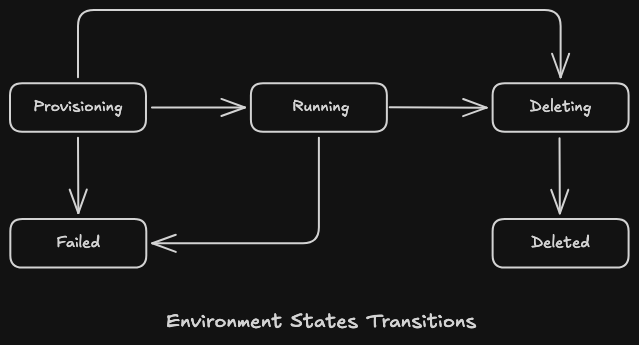

# Ephemeral Environment Manager

Creates short-lived, isolated environments on Docker or another provider (such as Kubernetes, AWS, GCP or Azure) for testing, reviewing PRs and reproducing production bugs. Humans use it through an API and agents through MCP.


Callers provide a workload image and choose `REGULAR_TESTING`, `PR_REVIEW`, or `PROD_BUG`. EEM checks permissions, resource quota, provider capacity, and cost budget (except for `PROD_BUG`) before provisioning. Background workers delete expired environments and recover stuck provisioning or deletion.

- **Types:** `PROD_BUG` > `PR_REVIEW` > `REGULAR_TESTING`. A higher type preempts a lower one when the capacity pool is full.
- **Lifecycle:** `PROVISIONING` → `RUNNING` → `DELETING` → `DELETED`, or `FAILED`.
- **Limits:** each caller has a quota shared across providers and a cost budget. Each provider has a capacity pool; normal types use up to 90%, `PROD_BUG` up to 100%.
- **Access:** each environment gets its own host name, routed by the proxy to the workload only. Agents can run commands in the workload to check a change.
- **Isolation:** each environment runs on its own internal network and can't reach other environments.
- **State:** everything lives in Postgres, so EEM recovers after a restart. Sign-in sessions live in Redis.
- **Templates:** versioned specs of the workload and its services (images, resources, env, healthchecks, TTL). Callers can override resources and TTL per environment.
- **Readiness:** an environment becomes `RUNNING` only once every container is running and healthy; one that never gets there is removed and marked `FAILED`.
- **Clusters:** nodes that share a network alias with the workload are routed to by that alias. Losing a minority of them reports `degraded` instead of `stopped`.
- **Cost:** priced per CPU core, GB of RAM and GB of disk per hour. The estimate is reserved at creation and the actual runtime is charged on delete.
- **Roles:** admins manage callers, templates, prices and capacity. Agents may create `PR_REVIEW`, and `PROD_BUG` only with permission and under a cost cap.
- **Auth:** callers sign in with GitHub and manage their own API keys. Admins sign in with a password. Sessions can be revoked on logout.
- **Agent keys:** an agent key belongs to a human caller and shares their quota and budget. It can be limited to a lower type and a spend cap, and only sees the environments it created.

<p align="center">
  
</p>

## Getting started

```sh
cp .env.example .env              # fill in the Postgres credentials, optionally the GitHub OAuth app
docker compose up -d --build      # postgres, redis, migrations, eem, worker and proxy
make seed-docker                  # Docker capacity pool and hourly prices
make admin ARGS="-username admin" # prompts for the password
make api-key                      # key for a new caller without GitHub; ARGS="-role agent" for an agent key
```

The dashboard is at http://localhost:8080 and MCP at http://localhost:8080/mcp. Environments are served at `env-<id>.env.localhost` on `PROXY_PUBLIC_PORT`.
