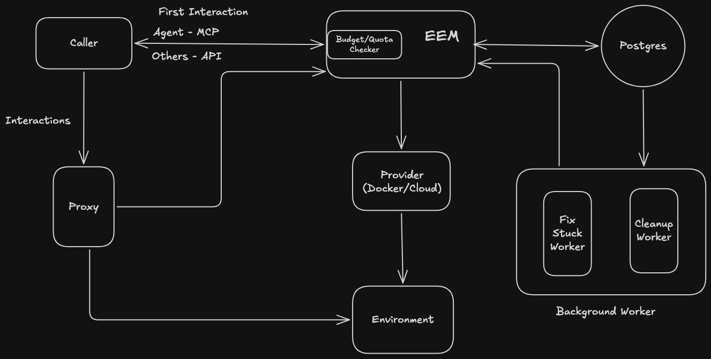

# Ephemeral Environment Manager

Creates short-lived, isolated environments on Docker or in the cloud for testing, reviewing PRs and reproducing production bugs. Humans use it through an API and agents through MCP.

Callers provide a workload image and choose `REGULAR_TESTING`, `PR_REVIEW`, or `PROD_BUG`. EEM checks permissions, resource quota, provider capacity, and cost budget (except for `PROD_BUG`) before provisioning. Background workers delete expired environments and recover stuck provisioning or deletion.

- **Types:** `PROD_BUG` > `PR_REVIEW` > `REGULAR_TESTING`. A higher type preempts a lower one when the capacity pool is full.
- **Lifecycle:** `PROVISIONING` → `RUNNING` → `DELETING` → `DELETED`, or `FAILED`.
- **Limits:** each caller has a quota shared across providers and a cost budget. Each provider has a capacity pool; normal types use up to 90%, `PROD_BUG` up to 100%.
- **Access:** each environment gets its own host name, routed by the proxy to the workload only. Agents can run commands in the workload to check a change.
- **Isolation:** each environment runs on its own internal network and can't reach other environments.
- **State:** everything lives in Postgres, so EEM recovers after a restart.
