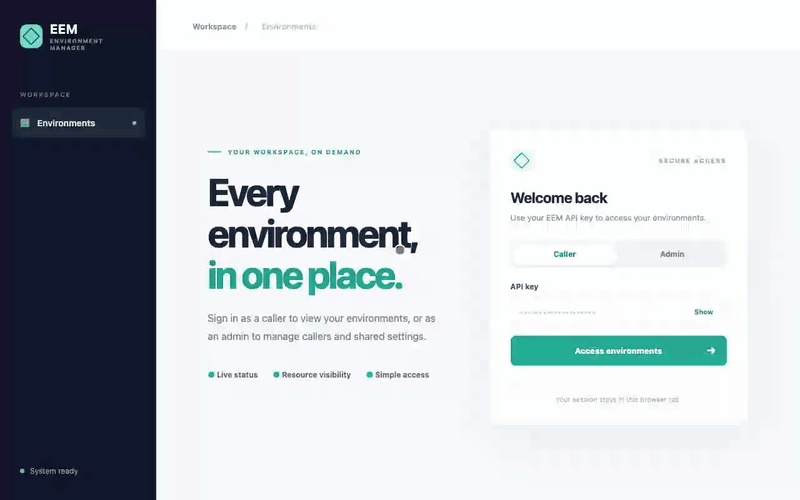
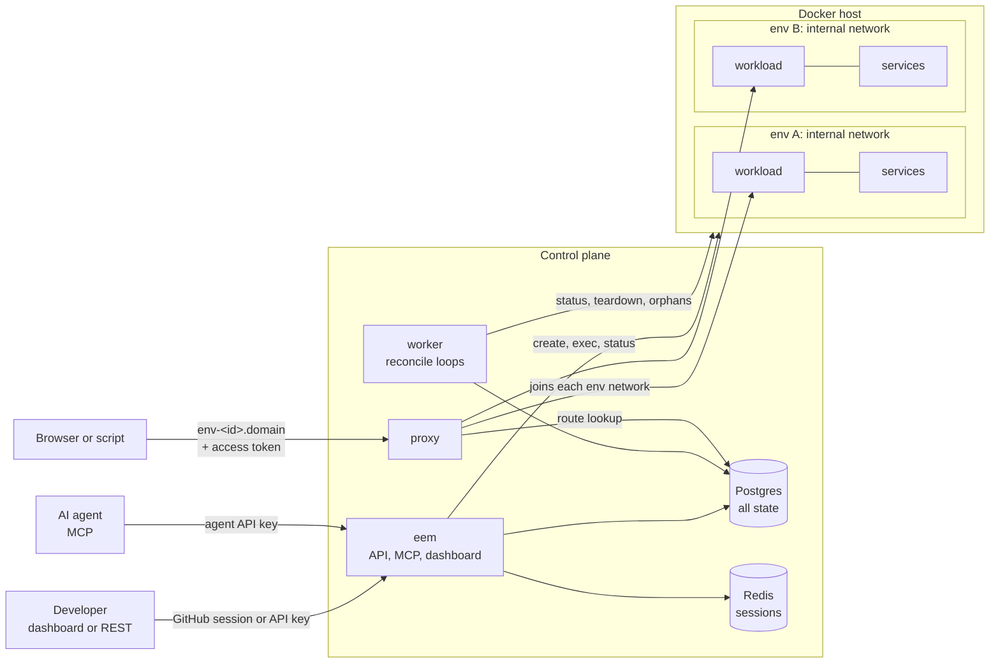
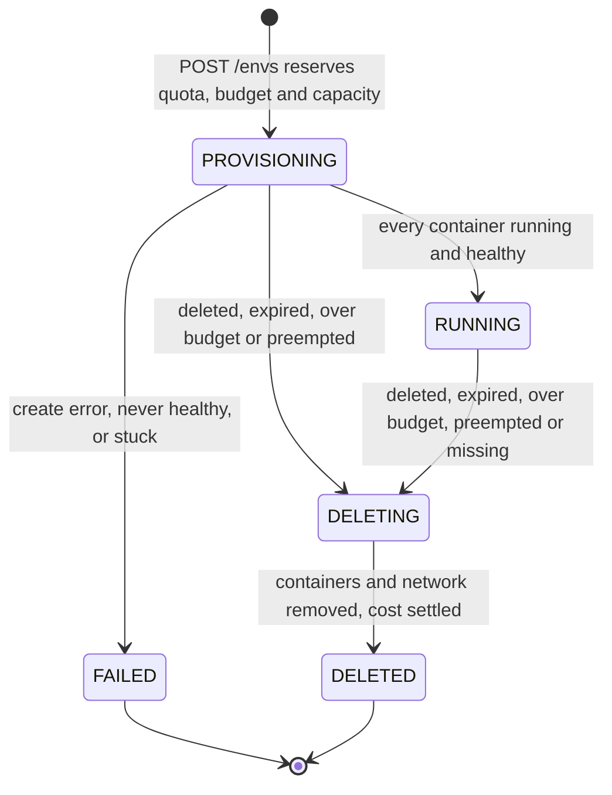
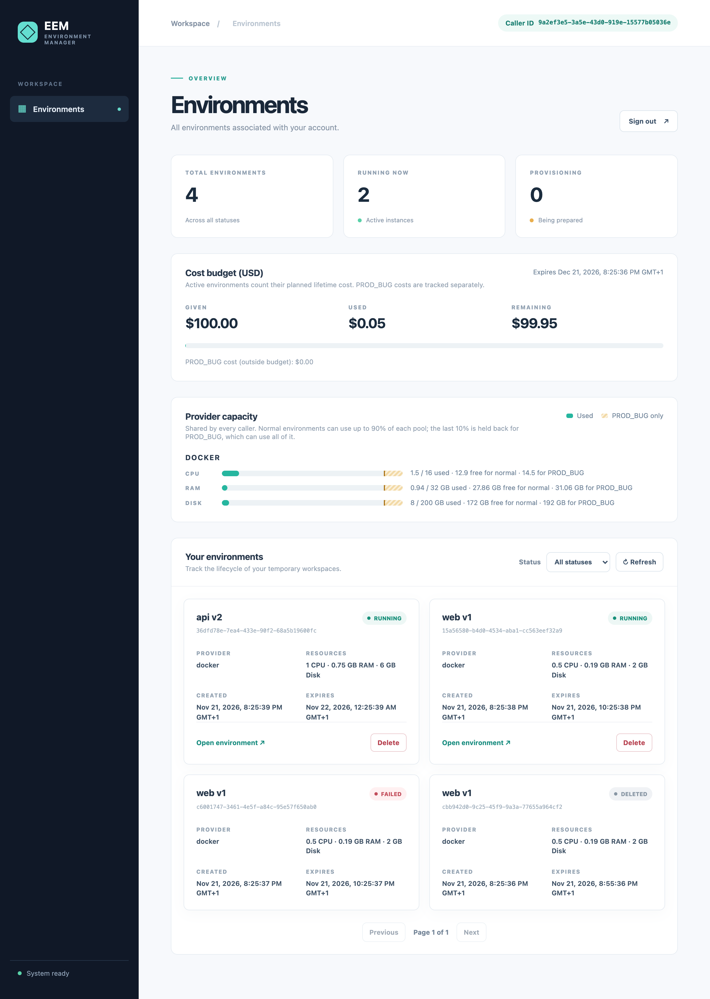

# Ephemeral Environment Manager

[](https://github.com/ademolahh/ephemeral-env-manager/actions/workflows/ci.yml)

EEM creates short-lived, isolated environments on Docker for testing, reviewing pull requests and reproducing production bugs. You give it a workload image and a template (the services the workload needs, such as Postgres or Redis). EEM starts them on a private network, puts them behind an authenticated URL and deletes them when their time is up.

Humans use it through a REST API and a dashboard. AI agents use it through MCP: an agent can create a `PR_REVIEW` environment, run the test suite inside it with `exec` and tear it down, all within a budget a human set.



Every caller has a resource quota and a cost budget, and every environment has a type: `PROD_BUG` outranks `PR_REVIEW`, which outranks `REGULAR_TESTING`. When capacity runs out, a higher type preempts lower ones. All state lives in Postgres, and a worker expires environments, reclaims stuck ones and removes containers no record owns.

## Architecture



| Service | Role |
| --- | --- |
| `eem` | API, MCP server and dashboard. It checks permissions, quota, budget and capacity in one transaction, then provisions in the background and watches readiness. |
| `worker` | Runs independent loops: expire environments past their TTL, stop ones whose caller is over budget, catch containers that vanished, resolve environments stuck in `PROVISIONING`, retry teardowns and remove orphaned containers. |
| `proxy` | Routes `env-<id>.<domain>` to that environment's workload after checking its access token. It joins each environment's network and listens only on its edge address, so workloads can't reach it or each other. |

## Lifecycle



Capacity is released when an environment leaves the active states. The reserved cost is settled to the actual runtime once it reaches `DELETED` or `FAILED`.

## Getting started

You need Docker with Compose and Go 1.27.

```sh
cp .env.example .env
# set POSTGRES_PASSWORD, REDIS_PASSWORD and PROXY_SECRET (openssl rand -hex 32)
# on Linux, also set DOCKER_GID=$(getent group docker | cut -d: -f3)

docker compose up -d --build --wait               # postgres, redis, migrations, eem, worker, proxy
make seed-docker ARGS="-cpu 8 -ram 16 -disk 100"  # capacity pool and hourly prices
make admin ARGS="-username admin"                 # prompts for a password
make api-key                                      # a caller and key; ARGS="-role agent" for an agent key
```

The `make` helpers run in a one-off `tools` container on the compose network, so they need no Go toolchain or database port. The dashboard is at http://localhost:8080. GitHub sign-in works once `GITHUB_CLIENT_ID` and `GITHUB_CLIENT_SECRET` are set.

## Walkthrough

An admin stores a template:

```sh
ADMIN=$(curl -s -X POST localhost:8080/admin/login \
  -d '{"username":"admin","password":"…"}' | jq -r .token)

curl -X POST localhost:8080/templates -H "Authorization: Bearer $ADMIN" -d '{
  "name": "web", "version": "v1", "providers": ["docker"], "default_provider": "docker", "ttl": "30m",
  "workload": {
    "ports": [80],
    "resources": {"cpu_millis": 250, "ram_mb": 128, "disk_gb": 1},
    "healthcheck": "wget -qO- http://127.0.0.1/ >/dev/null"
  },
  "services": [{
    "name": "cache", "image": "redis:7-alpine",
    "resources": {"cpu_millis": 250, "ram_mb": 64, "disk_gb": 1},
    "healthcheck": "redis-cli ping"
  }]
}'
```

A caller creates an environment from it:

```sh
curl -X POST localhost:8080/envs -H "Authorization: Bearer $KEY" -H "Idempotency-Key: pr-482" \
  -d '{"type": "REGULAR_TESTING", "workload": "nginx:alpine", "template": "web@v1"}'
```

```json
{
  "id": "bd10525e-…",
  "status": "PROVISIONING",
  "resources": {"cpu_millis": 500, "ram_mb": 192, "disk_gb": 2},
  "hourly_rate": 3078,
  "endpoint": "http://env-bd10525e-….env.localhost:8000",
  "access_url": "http://env-bd10525e-….env.localhost:8000/?eem_token=…",
  "access_token": "…"
}
```

Poll `GET /envs/{id}` until it's `RUNNING`, then reach it. Open `access_url` in a browser, or send the token from a script:

```sh
curl -H "X-EEM-Access-Token: $TOKEN" http://env-$ID.env.localhost:8000/
```

Run commands in the workload, then delete the environment:

```sh
curl -X POST localhost:8080/envs/$ID/exec -H "Authorization: Bearer $KEY" \
  -d '{"cmd": ["sh", "-c", "wget -qO- http://127.0.0.1/ | head -1"]}'
# {"output": "<!DOCTYPE html>\n", "exit_code": 0}

curl -X DELETE localhost:8080/envs/$ID -H "Authorization: Bearer $KEY"
```

When a check fails, the error has a stable code:

```json
{"error": "create environment: PROD_BUG with permission REGULAR_TESTING: environment type not permitted for caller", "code": "not_permitted"}
```

Every endpoint, body and error code is in the [API reference](docs/api.md).

### Dashboard

Callers see their environments, budget and the capacity left in each pool. Admins manage callers, budgets, templates, capacity and prices.



### Agents over MCP

Create an agent key (`make api-key ARGS="-role agent"`, or from the dashboard), then register the server with your MCP client, for example Claude Code:

```sh
claude mcp add --transport http eem http://localhost:8080/mcp --header "Authorization: Bearer $AGENT_KEY"
```

The agent gets `create_environment`, `get_environment`, `list_environments`, `exec`, `delete_environment`, `list_templates`, `get_template`, `get_budget` and `get_capacity`. An agent key shares its owner's quota and budget, can be capped lower, and only sees the environments it created.

## How it works

`POST /envs` decides admission in one transaction. It locks the caller, the API key and the capacity pool, always in that order, so concurrent requests can't both take the last slot or overspend a budget and the fixed order rules out deadlocks. Inside that transaction it checks permission, quota, budget and capacity. If the pool is full, it picks lower-priority victims (lowest type first, newest first within a type) and admits the new environment only if it then fits. Normal types can fill 90% of a pool; `PROD_BUG` can use all of it, so a production bug always gets a reproduction environment. Tests drive these races against a real Postgres.

Money is integers: prices are micro-USD per hour and budgets are cents. An environment's estimated cost is reserved when it's created, and its actual runtime is charged when it's deleted, in the same statement that releases its capacity.

Every status change is an `UPDATE … WHERE status = ANY(allowed)`, so the API, the background provisioner and the worker can race on one environment and the loser just sees `invalid_transition`. Because Postgres is the source of truth, a crash between commit and container creation is recovered by the worker, and eem resumes readiness checks for anything still provisioning when it restarts.

Each environment runs on its own internal Docker network, with no internet access and no route to other environments or the control plane. The proxy is the only way in. It checks an access token that is an HMAC of the environment's id under `PROXY_SECRET`, so eem and the proxy agree on it without sharing state, and it strips the token before forwarding.

## Security model

EEM runs images that callers choose and lets them run commands inside, so the containers are locked down: `no-new-privileges`, a process limit (`DOCKER_PIDS_LIMIT`, default 1024), CPU and memory limits with no extra swap, capped logs, and no `NET_RAW`, `MKNOD`, `AUDIT_WRITE` or `SETFCAP`. Disk is reserved and priced, and enforced per container only with `DOCKER_DISK_QUOTA=true`, which needs overlay2 on xfs with `pquota`.

The control-plane services run as the distroless nonroot user with a read-only root filesystem and no capabilities. Postgres and Redis publish no host ports, the admin ports bind to localhost, and Redis needs a password. API keys and session tokens are random 256-bit values stored only as SHA-256 hashes, admin passwords use bcrypt, and GitHub sign-in uses OAuth with state and PKCE. Admins own the template catalog: inline templates are recorded as `inline:<name>` with a hash of their spec, and `INLINE_TEMPLATES=false` turns them off.

What it doesn't protect against: eem and the worker can use the Docker socket, so they are as trusted as root on the host. Environments share the host kernel, so treat them as test isolation, not a sandbox for hostile code. A gVisor or Kata runtime would be the next step.

## Observability

Each service serves `/healthz`, `/readyz` and `/metrics` on `ADMIN_ADDR`. In compose these are `localhost:9090` for eem, `9091` for the worker and `9092` for the proxy. Logs are structured, through `slog`; set `LOG_FORMAT=json` for JSON.

| Metric | What it shows |
| --- | --- |
| `eem_environments{type,status}` | Environments by state, read from Postgres at scrape time |
| `eem_capacity_total`, `eem_capacity_used{provider,resource}` | Pool size and reservations |
| `eem_environments_created_total{type}`, `eem_preemptions_total{type}` | Admission and preemption |
| `eem_environment_ready_seconds` | Time from creation to healthy |
| `eem_provision_failures_total` | Environments that never became ready |
| `eem_worker_actions_total{action}`, `eem_worker_task_errors_total{task}` | What reconciliation is doing |
| `eem_http_requests_total{route,method,code}`, `eem_http_request_duration_seconds{route}` | API traffic |
| `eem_proxy_requests_total{code}` | Proxy traffic, including rejected tokens (401) |

## Configuration

Everything is set through environment variables; [.env.example](.env.example) lists them with defaults.

| Variable | Used by | Purpose |
| --- | --- | --- |
| `DATABASE_URL` | all | Postgres connection |
| `REDIS_URL` | eem | Session store |
| `PROXY_DOMAIN`, `PROXY_PUBLIC_PORT`, `PROXY_CONTAINER` | eem, worker, proxy | Environment host names and the proxy container to attach |
| `PROXY_SECRET` | eem, worker, proxy | Signs access tokens; at least 32 bytes |
| `GITHUB_CLIENT_ID`, `GITHUB_CLIENT_SECRET`, `GITHUB_ALLOWED_USERS`, `PUBLIC_URL` | eem | GitHub sign-in |
| `INLINE_TEMPLATES` | eem | `false` allows stored templates only |
| `DOCKER_PIDS_LIMIT`, `DOCKER_DISK_QUOTA` | eem, worker | Per-container limits |
| `EEM_INSTANCE` | eem, worker | Scopes this installation's containers so several can share a Docker host; compose sets it to the project name |
| `WORKER_INTERVAL` | worker | How often each reconcile loop runs (default `30s`) |
| `ADMIN_ADDR`, `LOG_FORMAT`, `LOG_LEVEL` | all | Operational endpoints and logging |

## Development

```sh
make test           # starts a throwaway Postgres and Redis (compose.test.yaml), then runs every test with -race
make test-db-down   # stops them
make lint           # golangci-lint
```

Integration tests run against real Postgres, Redis and Docker. The test databases are separate from the dev stack, keep their data in tmpfs and listen on loopback only. Each test gets its own schema or a rolled-back transaction, so they run in parallel. CI starts the same services and sets `TEST_REQUIRE_ALL=1`, so a test that would skip for a missing dependency fails instead.

Schema changes go in a new numbered migration in [migrations/](migrations/), applied by `migrate` in compose. `make migrate-new name=…` creates one.

## Limitations

Docker on a single host is the only provider, though providers sit behind an interface (`Create`, `Delete`, `Status`, `Address`, `Exec`, `List`). Run one eem and one worker: provisioning runs in eem's memory, so a second eem would see the first one's in-flight environments as missing, and the worker loops have no leader election.

Everything is plain HTTP, so put TLS in front of the proxy and eem. `exec` isn't streaming; it returns when the command ends, stops after 5 minutes and cuts output at 1 MiB, setting `truncated`. Template env values are stored as plain JSON, so keep production secrets out of templates. Access tokens can't be revoked one at a time: they end with the environment, or for every environment when `PROXY_SECRET` rotates.

## License

[MIT](LICENSE)
